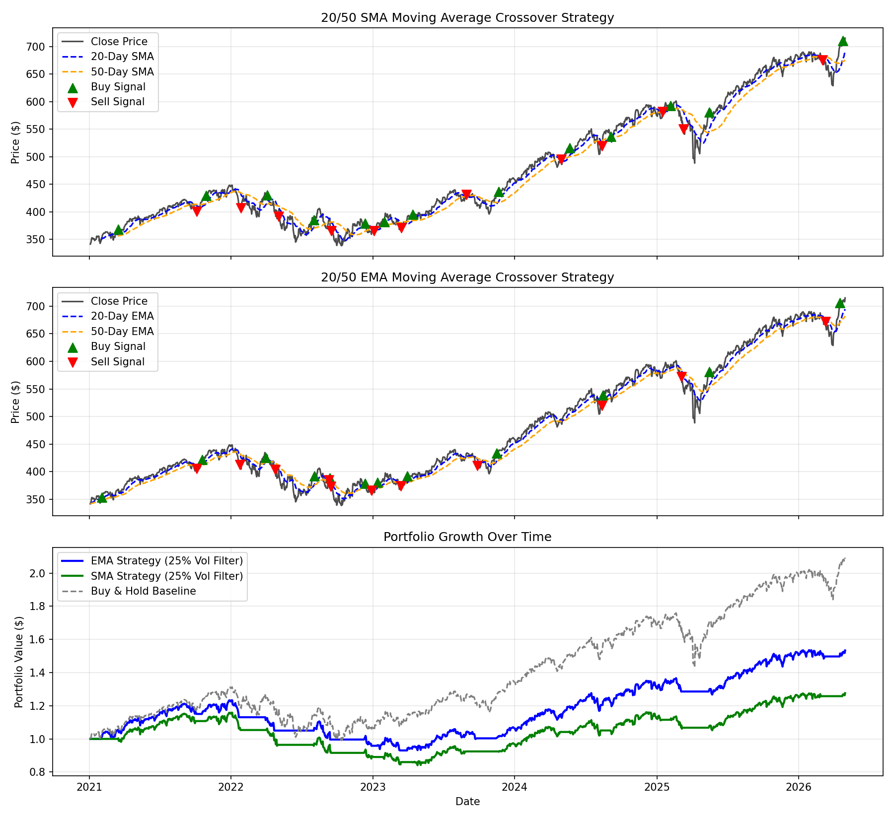

# Algorithmic Trading Backtester: SMA vs. EMA Crossover

A modular Python backtesting framework comparing **20/50-day Simple Moving Average (SMA)** and **Exponential Moving Average (EMA)** crossover strategies against a **Buy & Hold** benchmark over a 5-year historical window (`SPY`).



## Strategy Overview
Both moving average strategies share identical risk-management rules to ensure a controlled, apples-to-apples comparison:
* **Trend Signal:** Enter a long position (`1`) when the 20-day moving average crosses above the 50-day moving average; otherwise, exit to cash (`0`).
* **Volatility Filter:** Trades are only held when 20-day annualized rolling volatility ($\sigma \times \sqrt{252}$) is below **25%**, keeping the portfolio in cash during choppy, high-volatility drawdowns.
* **Look-Ahead Bias Prevention:** Signals generated at market close are shifted forward by 1 trading day (`shift(1)`) so trades execute on the next day's return.

## Backtest Results (5-Year Window)

| Strategy | Total Return (%) | Sharpe Ratio | Max Drawdown (%) |
| :--- | :---: | :---: | :---: |
| **20/50 SMA (25% Vol Filter)** | 27.59% | 0.48 | -27.39% |
| **20/50 EMA (25% Vol Filter)** | **53.36%** | **0.78** | **-24.55%** |
| **Buy & Hold (Benchmark)** | 109.33% | 0.91 | -24.50% |

### Key Takeaways
* **EMA vs. SMA:** Weighting recent prices more heavily allowed the EMA strategy to react faster to trend reversals, nearly doubling total return (`+25.77%` improvement) and significantly improving risk-adjusted performance (`0.78` vs. `0.48` Sharpe) over SMA.
* **Trend-Following Trade-off:** In a strong multi-year bull market, sitting in cash during pullbacks and volatility spikes protects capital during chop but lags a passive Buy & Hold benchmark in total return.

## Tech Stack
* **Python 3**
* **Pandas & NumPy**
* **yFinance** 
* **Matplotlib** 

## How to Run
1. Clone the repository:
   ```bash
   git clone [https://github.com/AyushB-dot/ma-crossover-backtester.git](https://github.com/AyushB-dot/ma-crossover-backtester.git)
   cd ma-crossover-backtester
   ```
2. Install dependencies:
   ```bash
   pip install -r requirements.txt
   ```
3. Run the backtester:
   ```bash
   python backtester.py
   ```

## Future Improvements
* Incorporate transaction costs / slippage per trade.
* Model idle cash yield using historical short-term T-bill rates instead of a 0% cash baseline.
